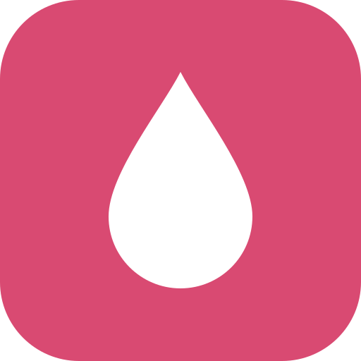
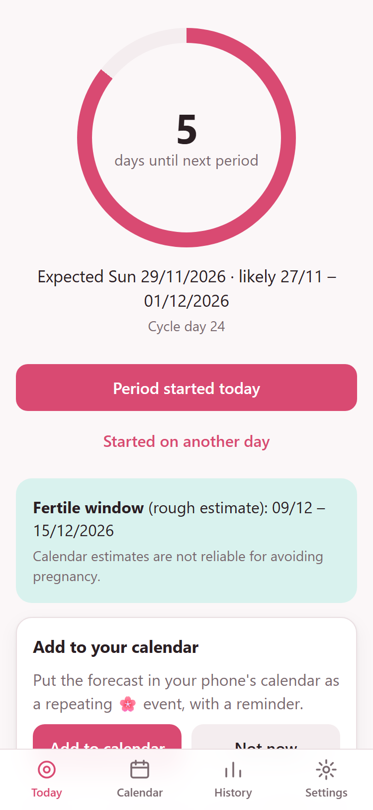
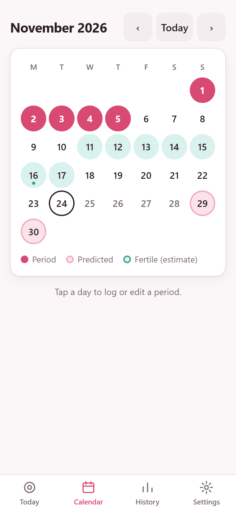
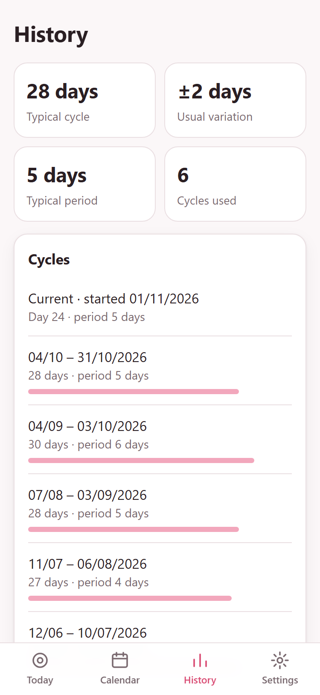

<div align="center">



# Cycle

**A private period tracker that never leaves your phone.**

No account · No server · No tracking · Works offline

[](LICENSE)


**[Try it →](https://lcucurachi.github.io/cycle/)**

</div>

<p align="center">
  
  &nbsp;
  
  &nbsp;
  
</p>

---

## 🔒 Privacy first

Cycle is built so that **your cycle data stays yours**. Health data is sensitive, so the app was designed around one rule: **nothing leaves the device unless you decide it should.**

| | |
|---|---|
| 📱 **Stored only on your phone** | Data lives in the browser's own database (IndexedDB) on your device. There is no server, no cloud and no sync. |
| 🙅 **No account** | No sign-up, email or password. Open it and start. |
| 🚫 **No tracking** | No analytics, ads, cookies, fingerprinting or third-party scripts. No external fonts or CDNs: every file comes from the app itself. |
| 🔌 **No outside servers** | The app only talks to the site it's hosted on, to load its own files and check for updates. Your data is never sent anywhere, and it works fully offline. |
| 🛡️ **Locked down** | A Content-Security-Policy only allows the app's own scripts, links don't reveal where you came from (`no-referrer`), and backup files are checked before import. |
| 🌸 **Discreet** | Calendar events are titled "🌸" by default (editable), not "Period". |
| 🗂️ **You own your data** | Export a backup file, import it on a new phone, or delete everything with one tap. |

**Only when you tap something** does anything leave the app:
- **Add to calendar** puts the forecast in your phone's calendar app. On iPhone this happens on the device. The *Google Calendar link* option (and the Android fallback) opens Google Calendar, so Google sees that event.
- **Research links** in Settings → About open the cited papers.

**Honest limits**
- Data isn't encrypted on the device: anyone who can unlock the phone and open the browser can see it, and exported backups are readable files.
- If you host your own copy on GitHub Pages, use a **dedicated GitHub account or organization (or a custom domain)**. All Pages sites of one account share the same web address, and the browser treats them as one site.

---

## ✨ Features

- **Log in one tap**: "Period started today" / "Period ended today", or tap any day in the calendar
- **Forecast** of the next period with a likely range (e.g. *29/11, likely 27/11 – 01/12*)
- **Late-period handling**: the forecast moves forward instead of staying in the past
- **Spots forgotten logs**: a cycle about twice your usual length triggers *"Did you forget to log a period around…?"*
- **Add to calendar**: one repeating event with a reminder, on iPhone and Android
- **Optional fertile-window estimate** (off by default, clearly marked as not contraception)
- **History**: typical cycle, variation, period length and every past cycle
- **Backup** export and import, **light and dark mode**, dates as `dd/mm/yyyy`

## 📈 How predictions work

1. A **cycle** is the number of days from one period start to the next.
2. Cycles that look like logging mistakes are left out: under 15 days, about double your usual length (a forgotten period), or over 90 days.
3. Your **typical cycle** is the median of your last 6 cycles, blended with your typical-cycle setting (default 29 days) while you have few cycles logged.
4. The **range** (±days) comes from how much your cycles vary.
5. The **fertile window** (optional) is a rough estimate: ovulation about 13 days before the next period.

Based on [Bull et al. 2019](https://pmc.ncbi.nlm.nih.gov/articles/PMC6710244) (600,000+ cycles), [Li et al. 2021](https://pmc.ncbi.nlm.nih.gov/articles/PMC8714275) (forgotten-log detection) and Apple's Cycle Tracking. Details are in [`js/predict.js`](js/predict.js).

## 📱 Install on your phone

| Phone | Steps |
|---|---|
| **iPhone** (Safari) | Share → **Add to Home Screen**. This also protects your data from Safari's automatic cleanup of sites not visited for 7 days. |
| **Android** (Chrome) | Menu ⋮ → **Install app** / **Add to Home screen** |

## 📅 Add to calendar

| Phone | What happens |
|---|---|
| **iPhone** | An `.ics` calendar file opens → **Add to Calendar** |
| **Android** | The phone's calendar app opens a pre-filled repeating event (falls back to a Google Calendar link) |
| **Anything else** | Settings → *Other ways to add*: download or share the `.ics` file |

When the forecast changes noticeably, the app tells you to update the event.

---

## 🚀 Host your own copy

1. Fork or push this repository to GitHub (ideally on a dedicated account, see [Privacy first](#-privacy-first)).
2. **Settings → Pages → Source: Deploy from a branch → `main` / `(root)`** → Save.
3. After a minute the app is at `https://<your-user>.github.io/<repo>/`.

### App settings at the top of `index.html`

| Setting | What it does |
|---|---|
| `app-version` | Change it when you publish an update (e.g. `1.0.1`). Shown in Settings → About; installed phones download the new files (visible from the second launch after the update). |
| `app-id` | Prefix for everything the app stores in the browser, so other apps on the same address don't clash. Set it once before publishing: changing it later means users start with empty data. |

If you add a new file, also add it to the `ASSETS` list in `sw.js` so it works offline.

## 🛠 Development

No build step and no dependencies: plain HTML, CSS and JavaScript modules.

```powershell
python -m http.server 8765
```

- App: http://localhost:8765
- Tests: http://localhost:8765/tests/ (prediction, dates, calendar export and backup safety)

| Path | What it is |
|---|---|
| `index.html` | The page and the app settings |
| `css/styles.css` | Styling (light + dark) |
| `js/app.js` | Screens and buttons |
| `js/predict.js` | Prediction logic |
| `js/calendar.js` | Add to calendar (.ics, Android, Google link) |
| `js/storage.js` | On-device storage, validation, backup |
| `js/dates.js` | Date helpers |
| `js/config.js` | Reads `app-id` / `app-version` from `index.html` |
| `sw.js`, `manifest.webmanifest`, `icons/` | Installable app + offline |
| `tests/index.html` | Automated tests (open in a browser) |
| `docs/screenshots/` | Images for this README |

## ⚠️ Disclaimer

Cycle gives **estimates only**. It is **not a medical device** and **not a method of contraception**. Talk to a healthcare professional about anything that worries you.

## 📄 License

[GNU General Public License v3.0](LICENSE): you can use, study, share and modify this app; modified versions you distribute must stay open source under the same license.
